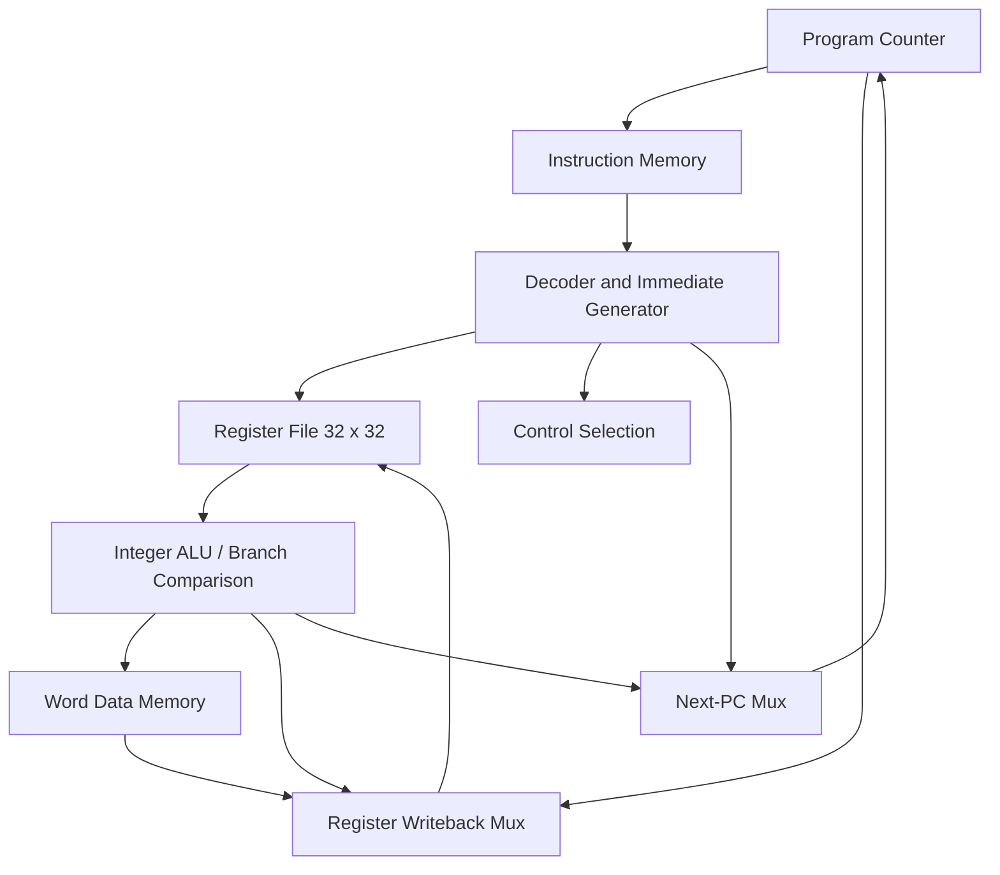

# Architecture: Single-Cycle RV32I Subset

## Hardware blocks

- **PC:** 32-bit register reset to `0`. Updated every rising edge. Normally adds 4; branches/jumps select new PC.
- **Decoder:** Uses `opcode`, `funct3`, `funct7` and immediate fields to select ALU operations, branches, and writeback.
- **Register file:** 32 registers x 32 bits; `x0` is hardwired to zero. Register values are written on the clock edge.
- **ALU:** Integer arithmetic, bitwise operations, comparisons and shifts with RV32 signedness where required.
- **Immediate generator:** Sign-extends I/S/B/J immediate fields; U-immediate zero-extends via 12-bit shift.
- **Load/store:** `LW` / `SW` word-aligned 32-bit accesses, with asynchronous memory reads for the educational single-cycle datapath.
- **Branch/jump:** Handles signed `BLT` and `BGE`, conditional equality branches, PC-relative `JAL`, and `JALR` with bit 0 cleared.
- **Illegal instruction:** `illegal_instr` output indicates unsupported encodings or misaligned word accesses; no trap or exception handler yet.

## Key design constraints

- Single-cycle design means one instruction commits per clock edge (CPI roughly 1 in this behavioral design); the clock period must accommodate the longest datapath.
- Memory wrappers are test-friendly and have limited fixed-size address spaces. They are **not** a deployable AXI/FPGA memory controller.
- The branch testbench checks both register results and load/store state. It also checks `x0` remains zero.

## v4 hardware improvements

- R-type and I-type ALU operations select a shared second operand before execution. Decoder checks for illegal funct7 encodings remain intact.
- A signed 33-bit right-shift input has an extra bit equal to `instr_data[30] & a[31]`. Logical shifts receive zero-fill; arithmetic shifts receive sign-fill. The low 32 result bits are used.
- x0 is tied to zero. Generated registers x1 through x31 each have synchronous reset and write enable. A packed 1024-bit read view selects 32-bit words using each five-bit source register index, creating mux trees.
- The register-file diagnostic view `regfile[0:31]` is retained for the original testbenches and waveforms.

These changes preserve the 29-instruction subset and external core interface. Future changes prioritize memory error handling; see `docs/roadmap.md`.
